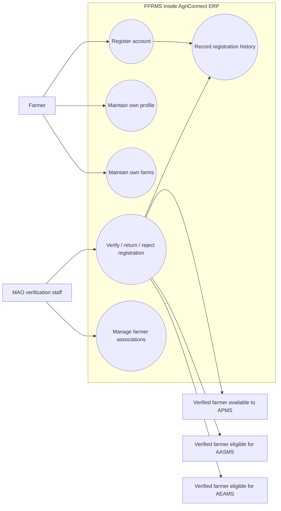
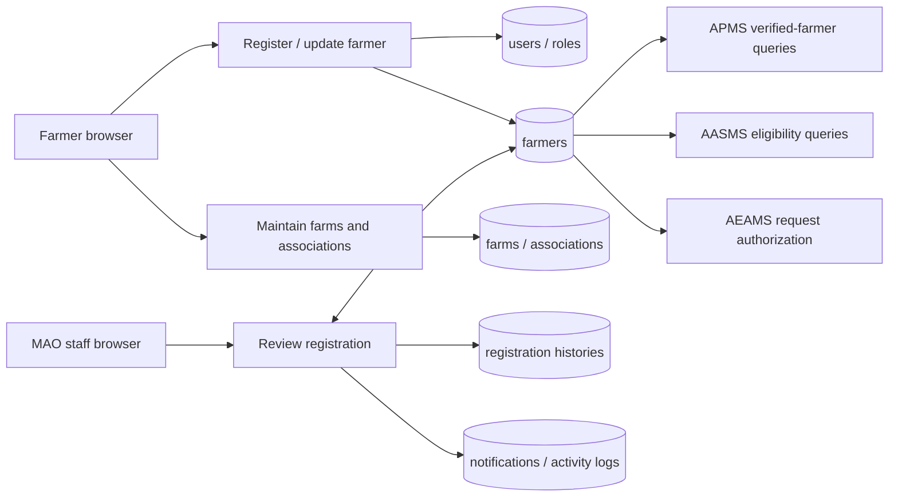
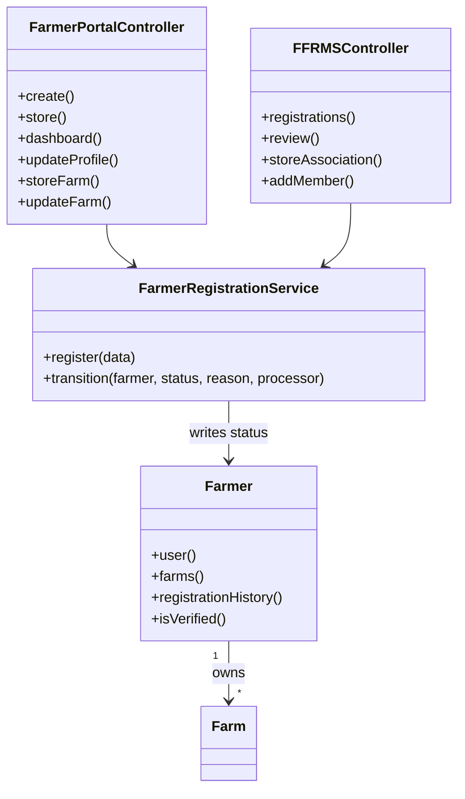
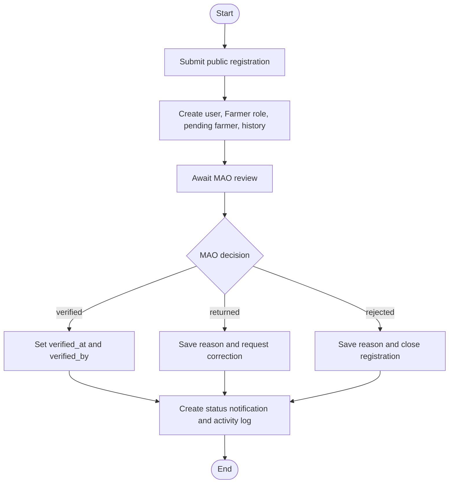
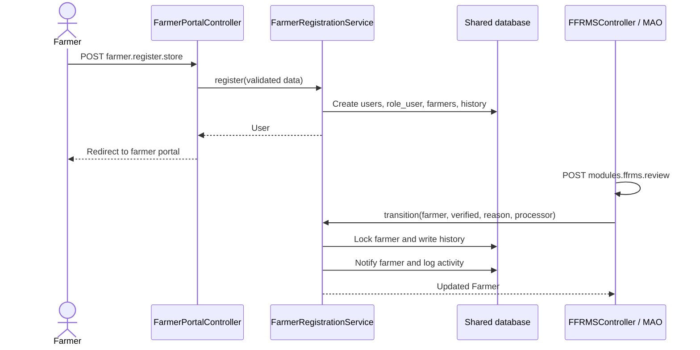

# FFRMS focused diagrams

## Use case



## Context and Level 1 DFD



## Focused ERD

```mermaid
erDiagram
    USERS ||--o| FARMERS : owns
    USERS ||--o{ FARMER_REGISTRATION_HISTORIES : processes
    FARMERS ||--o{ FARMER_REGISTRATION_HISTORIES : has
    FARMERS ||--o{ FARMS : registers
    USERS ||--o{ FARMER_ASSOCIATIONS : creates
    FARMER_ASSOCIATIONS ||--o{ FARMER_ASSOCIATION_MEMBERS : has
    FARMERS ||--o{ FARMER_ASSOCIATION_MEMBERS : joins
    USERS {
        bigint id PK
        string name
        string email UK
        boolean is_active
    }
    FARMERS {
        bigint id PK
        bigint user_id FK UK
        string farmer_code UK
        string registration_status
        bigint verified_by FK
        datetime verified_at
    }
    FARMS {
        bigint id PK
        bigint farmer_id FK
        string name
        string barangay
        decimal area
        string classification
        json agricultural_activities
    }
    FARMER_REGISTRATION_HISTORIES {
        bigint id PK
        bigint farmer_id FK
        string from_status
        string to_status
        bigint processed_by FK
        text reason
    }
    FARMER_ASSOCIATIONS {
        bigint id PK
        string name UK
        string status
        bigint created_by FK
    }
    FARMER_ASSOCIATION_MEMBERS {
        bigint id PK
        bigint association_id FK
        bigint farmer_id FK
        string membership_status
    }
```

## UML class view



## Activity



## Sequence


