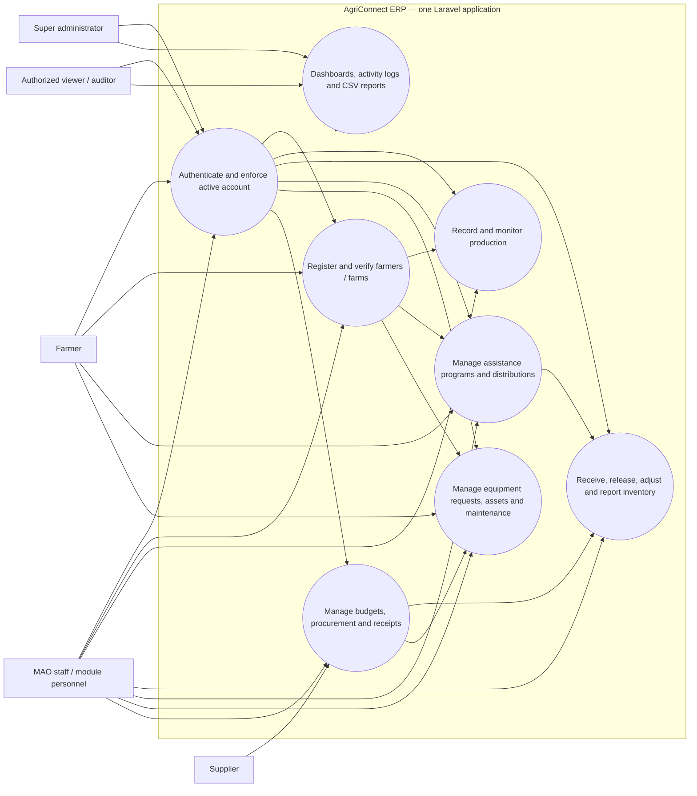
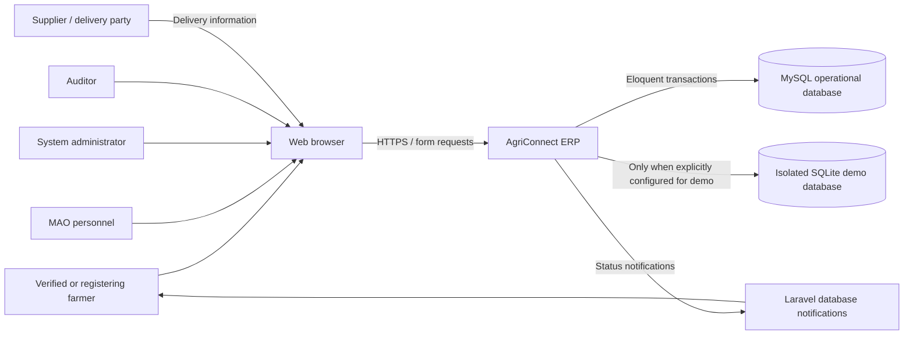
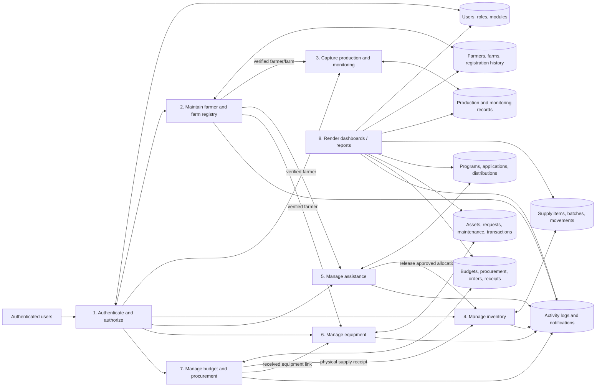
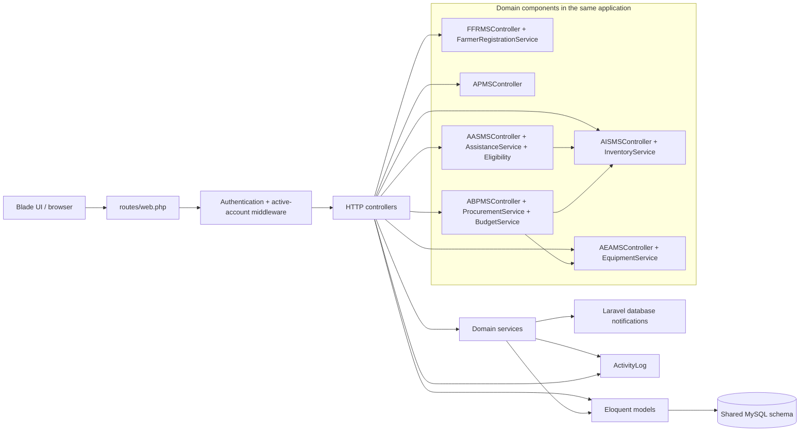
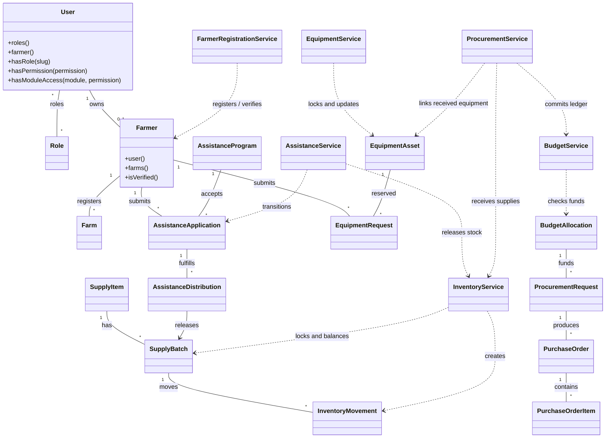
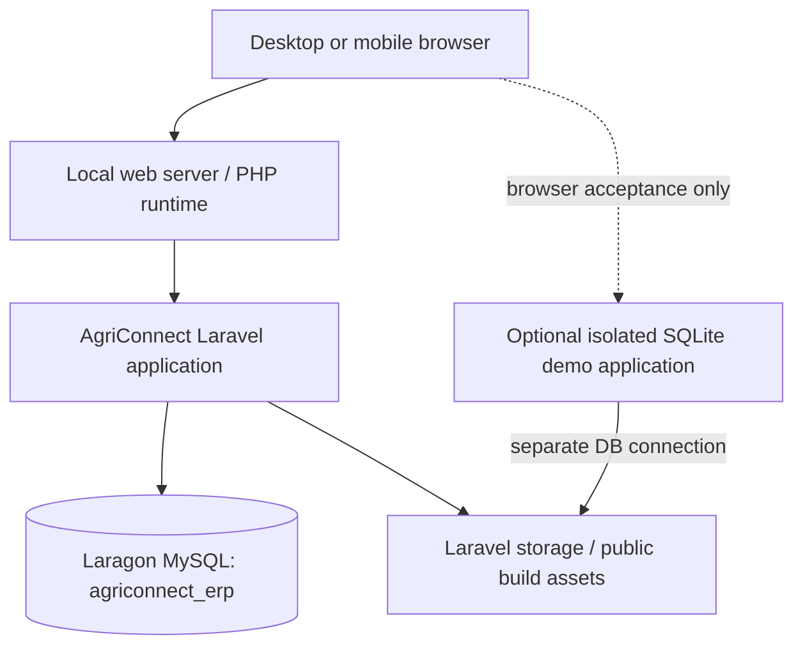
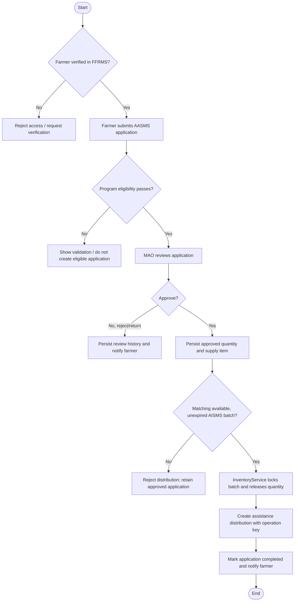
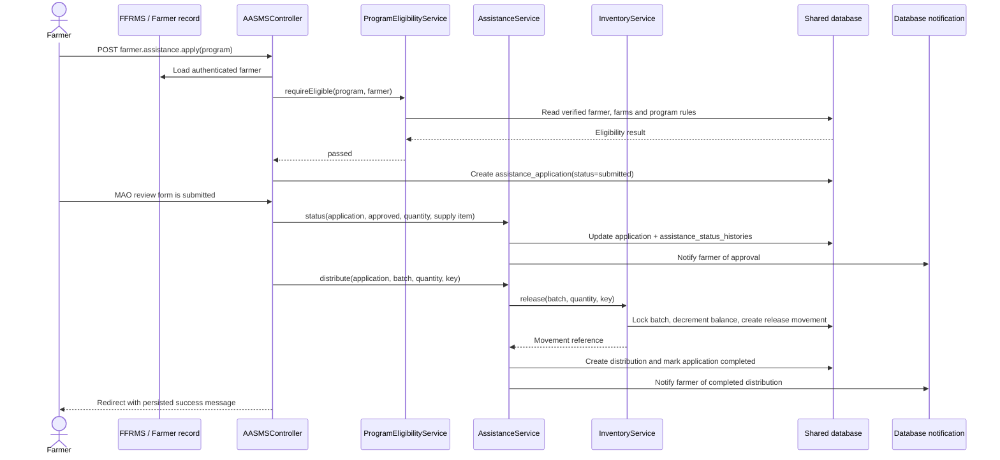

# Integrated ERP diagrams

The following Mermaid diagrams are source documentation. They are deliberately kept as text so they can be reviewed and regenerated by an academic team without changing application code.

## 1. Overall system use case

## 2. System context

## 3. Data flow diagram — Level 1

## 4. Consolidated entity relationship diagram

This is the logical consolidated model. Focused ERDs in the six domain folders are subsets of these entities.

```mermaid
erDiagram
    USERS ||--o{ ROLE_USER : assigned
    ROLES ||--o{ ROLE_USER : contains
    ROLES ||--o{ MODULE_ACCESS : grants
    MODULES ||--o{ MODULE_ACCESS : exposes
    USERS ||--o{ ACTIVITY_LOGS : causes
    USERS ||--o{ NOTIFICATIONS : receives

    USERS ||--o| FARMERS : owns
    USERS ||--o{ FARMER_REGISTRATION_HISTORIES : processes
    FARMERS ||--o{ FARMER_REGISTRATION_HISTORIES : records
    FARMERS ||--o{ FARMS : registers
    USERS ||--o{ FARMER_ASSOCIATIONS : creates
    FARMER_ASSOCIATIONS ||--o{ FARMER_ASSOCIATION_MEMBERS : has
    FARMERS ||--o{ FARMER_ASSOCIATION_MEMBERS : joins

    AGRICULTURAL_SEASONS ||--o{ CROP_PRODUCTION_RECORDS : scopes
    FARMERS ||--o{ CROP_PRODUCTION_RECORDS : produces
    FARMS ||--o{ CROP_PRODUCTION_RECORDS : hosts
    FARMERS ||--o{ LIVESTOCK_RECORDS : owns
    FARMS ||--o{ LIVESTOCK_RECORDS : hosts
    FARMERS ||--o{ FISHERY_RECORDS : owns
    FARMS ||--o{ FISHERY_RECORDS : hosts
    FARMERS ||--o{ PEST_DISEASE_INCIDENTS : reports
    FARMS ||--o{ PEST_DISEASE_INCIDENTS : affects
    FARMERS ||--o{ FARM_MONITORING_RECORDS : receives
    FARMS ||--o{ FARM_MONITORING_RECORDS : visits

    SUPPLY_CATEGORIES ||--o{ SUPPLY_ITEMS : groups
    UNITS_OF_MEASUREMENT ||--o{ SUPPLY_ITEMS : measures
    SUPPLY_ITEMS ||--o{ SUPPLY_BATCHES : stored_as
    INVENTORY_LOCATIONS ||--o{ SUPPLY_BATCHES : stores
    SUPPLY_BATCHES ||--o{ INVENTORY_MOVEMENTS : moves
    USERS ||--o{ INVENTORY_MOVEMENTS : posts
    SUPPLY_ITEMS ||--o| INVENTORY_ALERT_CONFIGURATIONS : alerts

    ASSISTANCE_PROGRAMS ||--o{ ASSISTANCE_APPLICATIONS : accepts
    SUPPLY_ITEMS ||--o{ ASSISTANCE_PROGRAMS : allocates
    FARMERS ||--o{ ASSISTANCE_APPLICATIONS : submits
    USERS ||--o{ ASSISTANCE_APPLICATIONS : reviews
    ASSISTANCE_APPLICATIONS ||--o{ ASSISTANCE_STATUS_HISTORIES : changes
    ASSISTANCE_APPLICATIONS ||--o{ ASSISTANCE_DISTRIBUTIONS : fulfills
    SUPPLY_BATCHES ||--o{ ASSISTANCE_DISTRIBUTIONS : supplies
    USERS ||--o{ ASSISTANCE_DISTRIBUTIONS : processes
    SUPPLY_ITEMS ||--o{ ASSISTANCE_APPLICATIONS : approved_item

    EQUIPMENT_CATEGORIES ||--o{ EQUIPMENT_ASSETS : classifies
    USERS ||--o{ EQUIPMENT_ASSETS : supervises
    FARMERS ||--o{ EQUIPMENT_REQUESTS : requests
    USERS ||--o{ EQUIPMENT_REQUESTS : submits
    EQUIPMENT_ASSETS ||--o{ EQUIPMENT_REQUESTS : reserved_for
    USERS ||--o{ EQUIPMENT_REQUESTS : reviews
    EQUIPMENT_ASSETS ||--o{ EQUIPMENT_MAINTENANCES : needs
    USERS ||--o{ EQUIPMENT_MAINTENANCES : reports
    EQUIPMENT_ASSETS ||--o{ EQUIPMENT_TRANSACTIONS : records
    EQUIPMENT_REQUESTS ||--o{ EQUIPMENT_TRANSACTIONS : explains
    USERS ||--o{ EQUIPMENT_TRANSACTIONS : performs

    BUDGET_PERIODS ||--o{ BUDGET_ALLOCATIONS : contains
    USERS ||--o{ BUDGET_ALLOCATIONS : creates
    BUDGET_ALLOCATIONS ||--o{ BUDGET_TRANSACTIONS : ledgers
    USERS ||--o{ BUDGET_TRANSACTIONS : performs
    PROCUREMENT_SUPPLIERS ||--o{ PURCHASE_ORDERS : receives
    BUDGET_ALLOCATIONS ||--o{ PROCUREMENT_REQUESTS : funds
    USERS ||--o{ PROCUREMENT_REQUESTS : requests
    USERS ||--o{ PROCUREMENT_REQUESTS : reviews
    PROCUREMENT_REQUESTS ||--o{ PROCUREMENT_REQUEST_ITEMS : contains
    SUPPLY_ITEMS ||--o{ PROCUREMENT_REQUEST_ITEMS : describes
    PROCUREMENT_REQUESTS ||--o{ PURCHASE_ORDERS : produces
    USERS ||--o{ PURCHASE_ORDERS : creates
    USERS ||--o{ PURCHASE_ORDERS : approves
    PURCHASE_ORDERS ||--o{ PURCHASE_ORDER_ITEMS : contains
    PROCUREMENT_REQUEST_ITEMS ||--o{ PURCHASE_ORDER_ITEMS : becomes
    SUPPLY_ITEMS ||--o{ PURCHASE_ORDER_ITEMS : supplies
    EQUIPMENT_ASSETS ||--o| PURCHASE_ORDER_ITEMS : links
    PURCHASE_ORDERS ||--o{ PROCUREMENT_RECEIPTS : receives
    USERS ||--o{ PROCUREMENT_RECEIPTS : records
    PROCUREMENT_RECEIPTS ||--o{ PROCUREMENT_RECEIPT_ITEMS : contains
    PURCHASE_ORDER_ITEMS ||--o{ PROCUREMENT_RECEIPT_ITEMS : received
    INVENTORY_MOVEMENTS ||--o{ PROCUREMENT_RECEIPT_ITEMS : creates
    INVENTORY_LOCATIONS ||--o{ PROCUREMENT_RECEIPT_ITEMS : stores
    PROCUREMENT_REQUESTS ||--o{ PROCUREMENT_STATUS_HISTORIES : tracks
    PURCHASE_ORDERS ||--o{ PROCUREMENT_STATUS_HISTORIES : tracks
    USERS ||--o{ PROCUREMENT_STATUS_HISTORIES : processes
```

## 5. UML component view

## 6. UML class view for core domain relationships

## 7. UML deployment view

## 8. Integrated activity — assistance to inventory

## 9. Integrated sequence — verified assistance distribution

